# Desk Widgets

Windows 바탕화면 위젯 엔진입니다. **엔진**(Electron 앱)을 한 번 설치하고, 필요한 **위젯**을 따로 설치합니다. 설치한 위젯은 모두 같은 엔진 안에서 실행되어, 위젯마다 Electron 앱을 따로 띄울 때보다 메모리를 크게 아낍니다. 창 관리, 바탕화면 고정(Win+D 뒤에도 남음), 위치 저장, 자동 실행, 알림 카드, 트레이 메뉴, 테마는 엔진이 공통으로 맡습니다.

> English summary: [below](#english).

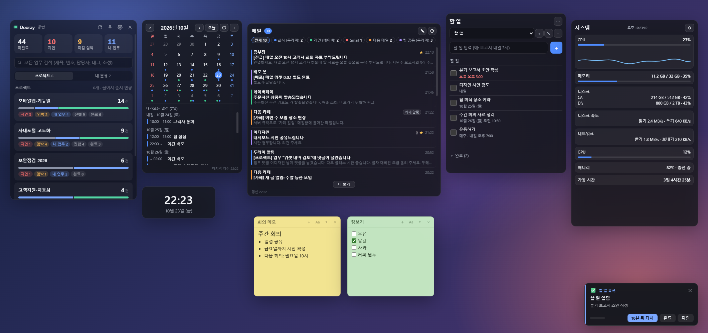

> 화면은 모두 가상의 예시 데이터입니다(`npm run screenshots`로 다시 만들 수 있습니다).

## 위젯

설치 파일 이름은 `<이름>-<버전>.exe`입니다.

### 두레이 대시보드

두레이 프로젝트의 업무 현황과 알림을 바탕화면에서 확인합니다. (`DeskWidgets-DoorayWidget-Setup`)

- 프로젝트별 미완료·지연·마감 임박·내 업무 건수와 담당자별 현황을 한 화면에서
- 멘션·배정·새 댓글·상태 변경·마감 지남을 알림 카드로 알려 줌
- 업무를 나만의 분류로 모아 보기(이 PC에만 저장, 두레이에는 보이지 않음)
- 제목·태그·담당자 검색, 초성 검색(ㅎㄱㄷ → 홍길동)
- 조건 알림: 정해 둔 시각에 일일보고 같은 등록이 없으면 알려 줌
- 프로젝트 하나를 별도 위젯 창으로 떼어 두기

**필요한 것**: 두레이 도메인과 API 토큰(두레이 → 설정 → API → 개인 인증 토큰)이 필요합니다.

| 프로젝트별 업무 현황 | 종이 테마 |
|---|---|
| 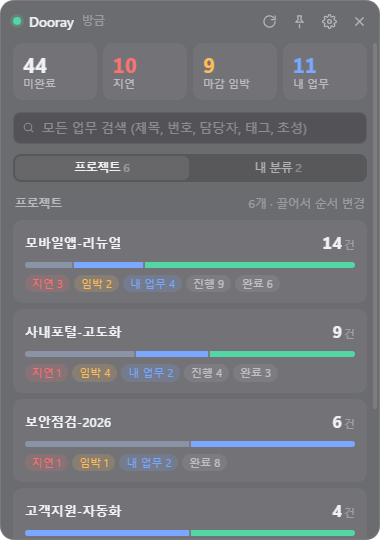 | 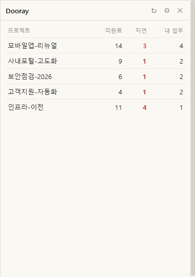 |

### 시계

초 표시·12시간제와 5가지 테마, 스톱워치·타이머·알람을 갖춘 바탕화면 시계. (`DeskWidgets-ClockWidget-Setup`)

- 테마 5종: 다크 글래스, 라이트, 미니멀, 네온 디지털, 아날로그(테마마다 배경 불투명도 조절)
- 초 표시와 오전/오후 12시간제를 켜고 끌 수 있음
- 스톱워치·타이머: 프리셋 3개, 끝나면 소리와 함께 알림 카드
- 알람: 반복 요일, 이름, 5분 뒤 다시 울림, 최대 20개
- 항상 위에 표시, 끌어서 위치 이동(기억), 받은 테마 추가

**필요한 것**: 따로 필요한 계정이나 설정이 없습니다.

| 다크 글래스(기본) | 초 표시 + 12시간제 | 라이트 테마 | 네온 디지털 + 초 |
|---|---|---|---|
| 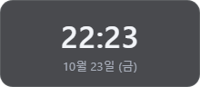 | 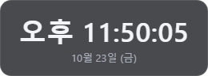 | 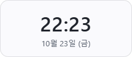 | 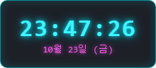 |

| 아날로그 + 초침 | 타이머 동작 중 | 알람 탭 |
|---|---|---|
| 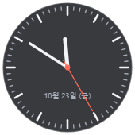 | 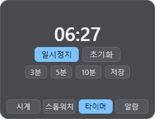 | 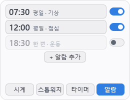 |

### 캘린더

CalDAV 계정과 ICS 구독의 일정을 한 달력에서 보고, 만들고, 고칩니다. (`DeskWidgets-CalendarWidget-Setup`)

- CalDAV 계정(iCloud·네이버·네이버 웍스·두레이 등)과 ICS 구독 주소(Google·Outlook·공휴일 등)를 색으로 구분해 한 달력에
- 월 달력과 다가오는 일정 목록, 날짜를 누르면 그날의 일정
- 큰 달력 테마: 날짜 칸 안에 일정이 보임
- CalDAV 계정의 쓸 수 있는 캘린더에는 일정 만들기·수정·삭제(ICS 구독은 읽기 전용)
- 받아 둔 일정은 PC에 저장해 다시 켜도, 인터넷이 끊겨도 바로 보임
- 한 주의 시작(일요일·월요일) 선택

**필요한 것**: CalDAV 계정(아이디와 앱 전용 비밀번호) 또는 ICS 구독 주소가 필요합니다.

| 큰 달력 테마: 날짜 칸 안에 일정 | 월 달력과 다가오는 일정 |
|---|---|
| 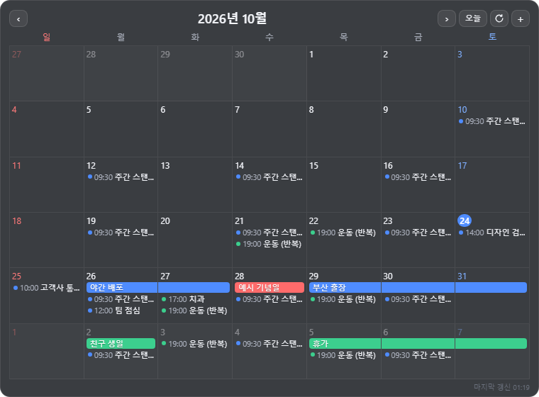 | 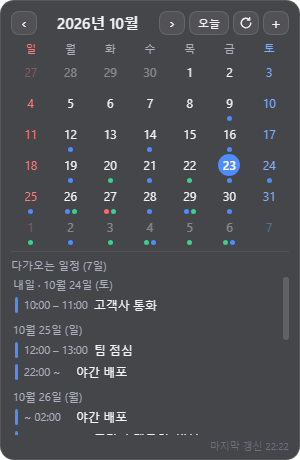 |

### 메일

여러 메일 계정의 받은편지함을 한 목록으로 보고, 새 메일 알림을 받고, 바로 답장합니다. (`DeskWidgets-MailWidget-Setup`)

- IMAP 계정(두레이·네이버·다음·Gmail·기타)의 받은편지함을 받은 시각 순 한 목록으로, 계정은 색으로 구분
- 새 메일 알림 카드(전체 또는 계정별로 끌 수 있음)
- 본문 보기, 서식·이미지가 있는 원문은 안전한 별도 창에서 보기
- 답장·전체 답장·전달·새 메일 쓰기(위젯에서 보내거나 메일 프로그램·웹메일로)
- 메일 분류(중요·결재 등)와 주소록 자동 완성(이 PC에만 저장)
- 테마 3종: 기본, 작은 카드, 계정 대시보드

**필요한 것**: 메일 계정의 IMAP 사용 설정과 비밀번호가 필요합니다(Gmail은 앱 비밀번호, 네이버는 2단계 인증이면 애플리케이션 비밀번호). Outlook.com·Microsoft 365는 아직 연결할 수 없습니다.

| 여러 계정을 한 목록으로 | 계정 대시보드 테마 | 작은 카드 테마 | 새 메일 알림 카드 |
|---|---|---|---|
| 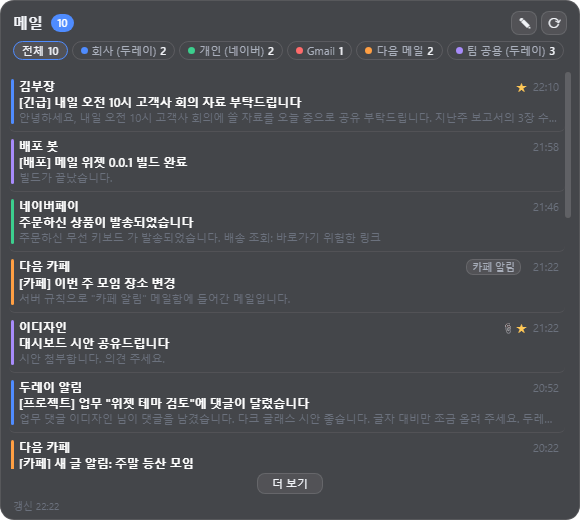 | 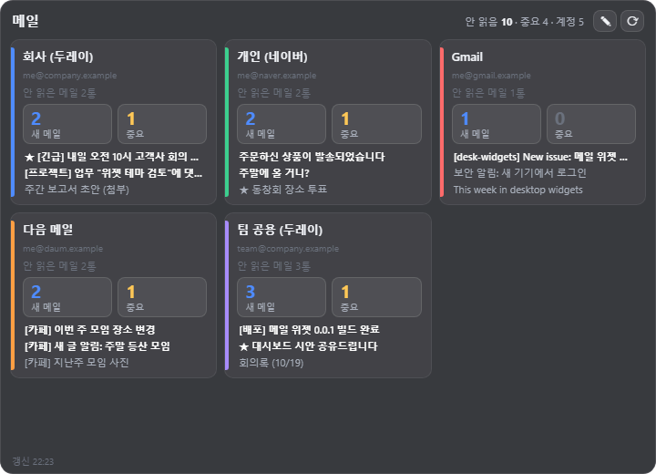 | 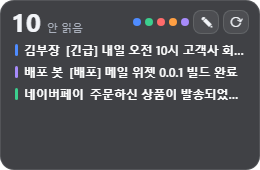 | 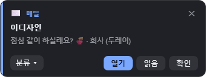 |

### 할 일 목록

빠르게 적고 완료하는 할 일 목록. 한국어 날짜 입력, 반복, 알림을 지원합니다. (`DeskWidgets-TodoWidget-Setup`)

- 입력하고 Enter로 추가, 체크하면 완료 항목 아래로 접힘
- 입력 끝에 한국어 날짜: 내일 오후 3시, 다음 주 월요일, 매주 금요일 15:30
- 시간이 되면 알림 카드에서 완료하거나 다시 알림(기본 10분 뒤)
- 목록을 여러 개 만들고, 할 일은 끌어서 순서 바꾸기
- 두레이 업무·메일을 할 일로 추가하고 마감일을 캘린더에 표시(설정에서 켜면)
- 테마 2종: 다크 글래스, 오션

**필요한 것**: 따로 필요한 계정이나 설정이 없습니다. 할 일은 이 PC에만 저장됩니다.

| 날짜와 반복이 있는 할 일 | 할 일 알림 카드 |
|---|---|
| 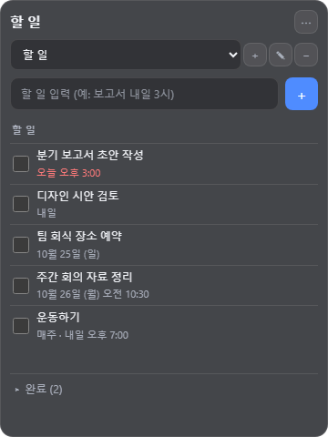 | 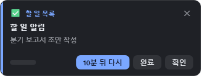 |

### 스티키 노트

노트마다 창 하나, 서식이 보이는 채로 쓰고 Markdown 파일로 저장하는 스티키 노트. (`DeskWidgets-StickyNoteWidget-Setup`)

- 노트마다 작은 창 하나, 서식이 보이는 상태로 바로 고침(굵게·제목·체크 목록·코드·표·링크)
- 이미지 붙여넣기와 파일 첨부
- 문서 폴더에 Markdown(.md) 파일로 자동 저장: Obsidian·VS Code와 같은 폴더를 쓰면 바깥 수정도 바로 보임
- [[노트 이름]]으로 노트끼리 연결, 이름을 바꾸면 링크도 따라 바뀜
- 노트 색 7가지, 항상 위, 접기, 검색이 되는 노트 목록과 보관함

**필요한 것**: 따로 필요한 계정이나 설정이 없습니다. 노트는 문서 폴더의 파일이라 위젯을 지워도 남습니다.

| 회의 메모 | 체크 목록 | 제목과 번호 목록 |
|---|---|---|
| 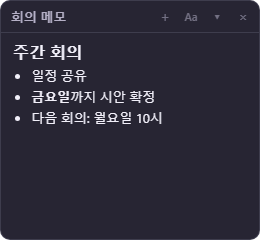 | 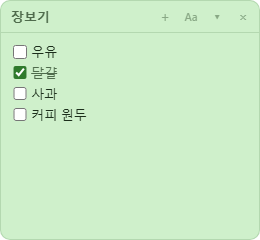 | 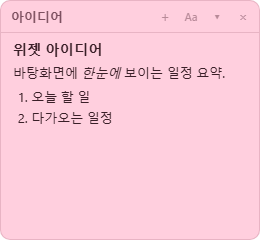 |

### 할 일 노트

날짜를 걸면 할 일이 되는 노트. 노트마다 창 하나, Markdown 파일로 저장하고 알림·반복·캘린더 마감까지. (`DeskWidgets-TodoNoteWidget-Setup`, [사용법](docs/todonote.md))

- 날짜를 걸면 노트가 할 일이 됨: "내일 3시", "10/30", "매월 1일"처럼 말로 입력
- 마감 시각에 알림 카드: 완료·다시 알림·노트 열기
- 반복(매주 금, 매월 말일, 완료 후 30일 등): 완료하면 다음 회차로, 체크 목록도 비움
- 완료한 노트는 완료 폴더로, 정한 기간(기본 30일) 뒤 Windows 휴지통으로
- 할 일 목록은 지남·오늘·곧·나중으로 묶어 보기, 캘린더에 마감 표시, 두레이·메일에서 할 일로 추가(설정에서 켜면)

**필요한 것**: 따로 필요한 계정이나 설정이 없습니다. 스티키 노트와 함께 설치해도 되며 노트 폴더는 따로 씁니다.

| 마감이 지난 할 일 노트 | 할 일 목록 | 날짜 창 |
|---|---|---|
| 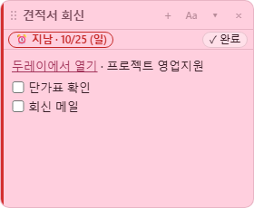 | 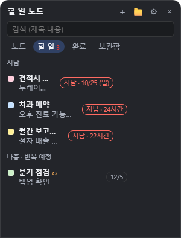 | 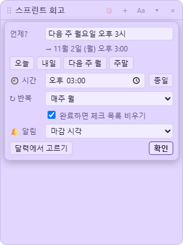 |

### 시스템 모니터

CPU·메모리·디스크·네트워크·GPU·배터리 상태를 한눈에 보여 줍니다. (`DeskWidgets-SystemMonitorWidget-Setup`)

- CPU 사용률과 최근 기록 그래프(설정에서 코어별 보기)
- 메모리, 드라이브별 여유 공간, 디스크 읽기·쓰기 속도
- 네트워크 송수신 속도, GPU 사용률, 배터리, 가동 시간
- 테마 4종: 다크 글래스, 오션 그래프, 막대, 미니 바
- 측정 간격 1~10초 선택, 창이 가려지거나 자리를 비우면 측정을 멈춰 가볍게 동작

**필요한 것**: 따로 필요한 계정이나 설정이 없습니다. GPU 카운터나 배터리가 없는 PC에서는 그 항목이 '측정 불가'로 보입니다.

| 다크 글래스 | 오션 그래프 + 코어별 CPU | 막대 테마 |
|---|---|---|
| 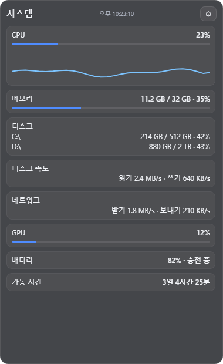 | 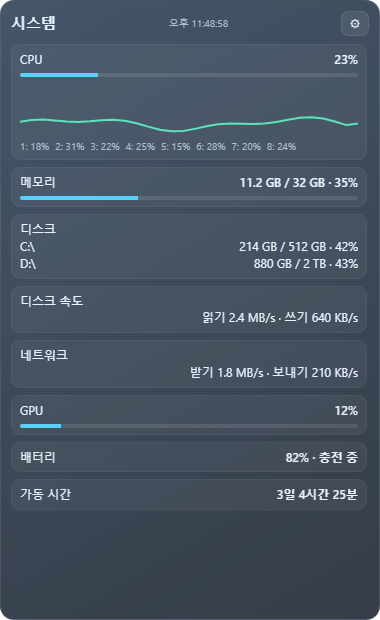 | 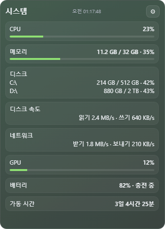 |

## 설치

설치 파일은 [다운로드 페이지](https://widgets.chilgong88.com)(항상 최신 버전) 또는 [Releases](https://github.com/Htaeyong/desk-widgets/releases)에서 받습니다. 엔진과 위젯은 버전과 릴리스가 따로 있습니다(엔진 `engine-v…`, 위젯 `widget-<id>-v…`).

1. **엔진** `DeskWidgets-Setup-<버전>.exe`를 먼저 설치합니다(관리자 권한, 모든 사용자). 위젯은 들어 있지 않습니다.
2. 원하는 **위젯** 설치 파일을 설치합니다. 설치하면 실행 중인 Desk Widgets에 바로 나타납니다. 엔진이 없으면 위젯 설치 파일이 먼저 엔진을 설치하라고 알려 줍니다.
3. 사용할 위젯은 작업 표시줄 오른쪽의 트레이 아이콘 → **위젯 관리 · 설정**에서 고릅니다.

> 설치 파일에 코드 서명이 없어 처음 실행할 때 Windows SmartScreen 경고("Windows의 PC 보호")가 뜰 수 있습니다. **추가 정보 → 실행**을 누르세요.

자세한 사용법은 [사용자 가이드](docs/user-guide.md)에 있습니다. 위젯을 제거할 때는 설정을 함께 지울지 고를 수 있고, 엔진과 위젯은 Windows 설정의 앱 목록에서 따로 제거합니다.

## 테마

두레이 대시보드, 시계, 캘린더, 메일, 시스템 모니터, 할 일 위젯의 화면은 **테마 폴더** 하나로 통째로 바꿀 수 있습니다. 테마는 HTML·CSS·JS로 만들고, 격리된 창에서 실행되어 인터넷에 접속하거나 파일에 접근할 수 없습니다. 위젯 설정의 테마 칸에서 **테마 폴더 열기**로 받은 테마를 넣고 **목록 새로고침**을 누르면 됩니다.

- 시작하기: [테마 만들기](docs/theme-guide.md) (색만 바꾸는 가장 작은 테마부터 위젯별 예제까지)
- 규격: [공통 테마 규격](docs/THEME_SPEC.md), [두레이](docs/THEME_SPEC-dooray.md)·[시계](docs/THEME_SPEC-clock.md)·[캘린더](docs/THEME_SPEC-calendar.md)·[메일](docs/THEME_SPEC-mail.md)·[시스템 모니터](docs/THEME_SPEC-system-monitor.md)·[할 일](docs/THEME_SPEC-todo.md)
- 위젯 만들기: [위젯 개발 가이드](docs/widget-dev.md)

만든 테마를 공유하고 싶으면 [CONTRIBUTING.md](CONTRIBUTING.md)를 보세요.

## 소스에서 빌드하기

Windows 10/11, [Node.js](https://nodejs.org/) LTS, Git이 필요합니다.

```bash
git clone https://github.com/Htaeyong/desk-widgets.git
cd desk-widgets
npm ci
npm test                 # 단위 테스트
npm start                # 엔진 실행 (저장소 widgets/ 의 위젯을 불러옴)
npm start -- --mock-data # 계정 없이 예시 데이터로 실행
npm run screenshots      # README 스크린샷을 예시 데이터로 다시 만들기 → docs/images/
npm run dist             # 엔진 설치 파일 → dist/
npm run dist:widgets     # 위젯 패키지와 설치 파일 → dist/
```

위젯 설치 파일은 [NSIS](https://nsis.sourceforge.io/)로 만듭니다. `npm run dist`를 한 번 실행하면 electron-builder가 받아 둔 `makensis`를 쓰고, 다른 NSIS를 쓰려면 `MAKENSIS` 또는 `NSIS_DIR` 환경 변수로 지정합니다. 두레이 위젯을 실제 계정으로 확인하려면 `.env.example`을 `.env`로 복사해 `DOORAY_API_KEY`를 채우고 `npm run check-api`를 실행합니다.

## 개인정보

Desk Widgets는 사용 기록이나 개인정보를 수집하지 않습니다. 계정 비밀번호와 API 토큰은 이 PC에 Windows 암호화(DPAPI)로 저장되고 해당 서비스에만 보냅니다. 자세한 내용은 [개인정보 안내](docs/privacy.md)를 보세요.

## Code signing policy

Desk Widgets has applied to [SignPath Foundation](https://signpath.org/) for free code signing for open source projects. Once approved: free code signing provided by [SignPath.io](https://about.signpath.io/), certificate by [SignPath Foundation](https://signpath.org/). Current installers are not signed yet.

- Committers and reviewers: [@Htaeyong](https://github.com/Htaeyong)
- Approvers: [@Htaeyong](https://github.com/Htaeyong)

Only installers built by this repository's GitHub Actions workflow (`.github/workflows/release.yml`) from a release tag
are signed; every signing request is approved by hand. Locally built files are never signed.

Privacy: Desk Widgets does not transfer any information to other networked systems unless the user configures it
(for example a Dooray, mail or calendar account). See [docs/privacy.md](docs/privacy.md).

코드 서명은 SignPath Foundation에 신청한 상태이고, 승인되면 위 정책대로 서명합니다. 자세한 절차는 [코드 서명과 백신 오탐 대응](docs/code-signing.md)에 있습니다.

## 문의와 기여

버그 제보, 기능 제안, 질문은 [GitHub Issues](https://github.com/Htaeyong/desk-widgets/issues)에 남겨 주세요. 기여 방법은 [CONTRIBUTING.md](CONTRIBUTING.md)에 있습니다.

## 라이선스

[MIT](LICENSE). 무료로 쓰고, 고치고, 배포할 수 있습니다.

## 상표

Dooray!는 NHN Dooray, Gmail은 Google LLC, Outlook은 Microsoft Corporation, iCloud는 Apple Inc., 네이버(Naver)와 NAVER WORKS는 NAVER Corp. 및 그 계열사, 다음(Daum)은 Kakao Corp.의 상표입니다. Desk Widgets는 이 회사들과 관계가 없으며, 이 회사들이 보증하거나 후원하는 제품이 아닙니다. 서비스 이름은 연결할 수 있는 서비스를 알리기 위해서만 씁니다.

---

## English

**Desk Widgets** is a desktop widget engine for Windows built on Electron. You install the engine once and add widgets as separate installers; all widgets run inside the same engine process. The engine handles windows, pinning to the desktop (survives Win+D), positions, autostart, notification cards, the tray menu and themes.

Widgets: Dooray! dashboard, calendar (CalDAV/ICS), mail (IMAP/SMTP), clock, sticky notes, to-do notes (notes that become to-dos with a due date), system monitor and to-do list. The UI is in Korean.

- **Install**: download from https://widgets.chilgong88.com (always the latest) or [Releases](https://github.com/Htaeyong/desk-widgets/releases), install the engine `DeskWidgets-Setup-<version>.exe` first, then any widget installer. The installers are not code-signed, so Windows SmartScreen may warn on first run: choose **More info → Run anyway**.
- **Themes**: every themed widget's UI is a replaceable folder of HTML/CSS/JS running in an isolated, offline window. See [docs/theme-guide.md](docs/theme-guide.md) (Korean).
- **Build**: `npm ci`, `npm test`, `npm start` (add `-- --mock-data` for sample data), `npm run dist`.
- **Privacy**: no telemetry, no data collection. Account passwords and API tokens are encrypted on your PC with Windows DPAPI (Electron `safeStorage`) and sent only to the service they belong to. See [docs/privacy.md](docs/privacy.md).
- **Issues**: [GitHub Issues](https://github.com/Htaeyong/desk-widgets/issues). **License**: [MIT](LICENSE).
- **Trademarks**: Dooray!, Gmail, Outlook, iCloud, Naver, Daum and NAVER WORKS are trademarks of their respective owners. This project is not affiliated with or endorsed by them.
