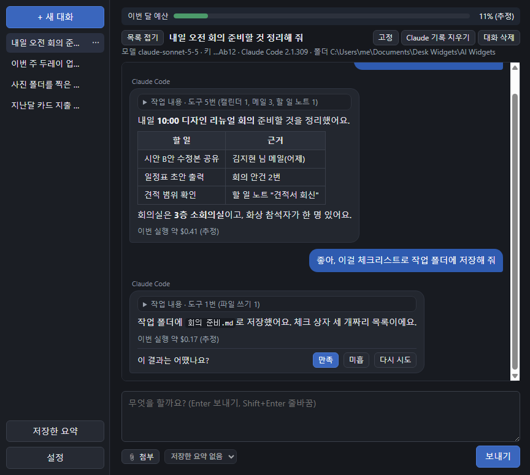
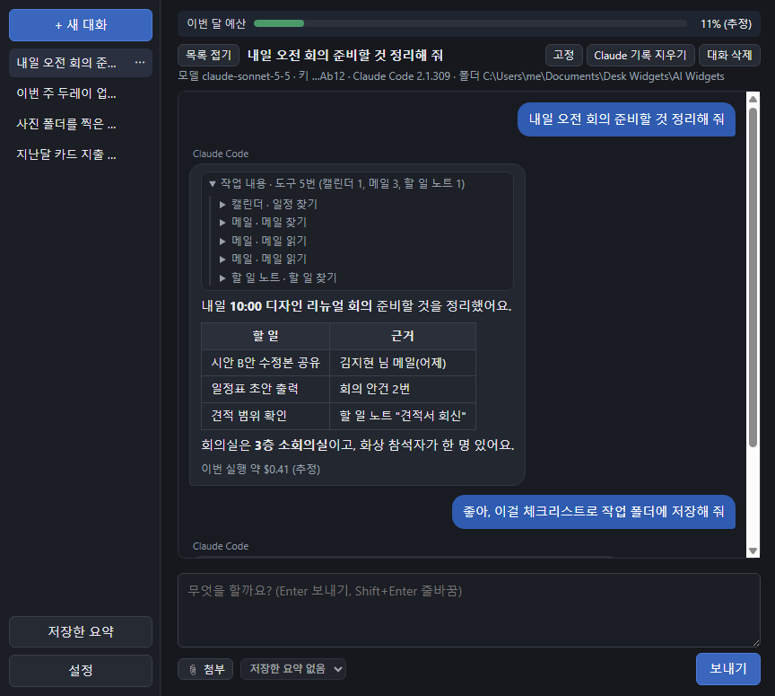
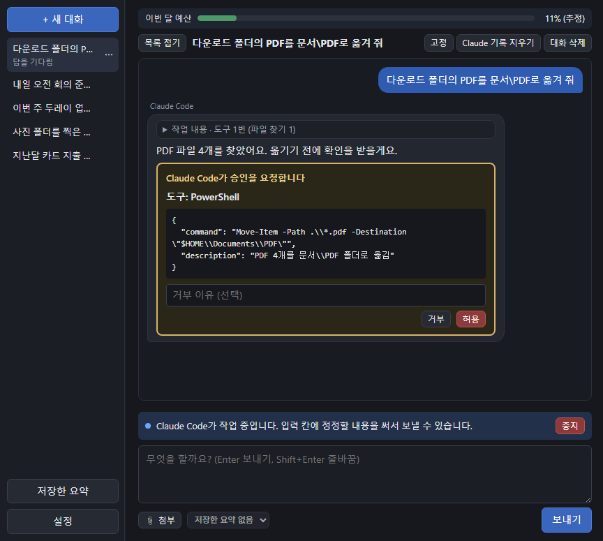

# AI Widgets 위젯 (ai-chat)

> **AI Widgets**는 Desk Widgets에 따로 설치하는 위젯 하나의 이름입니다(내부 id `ai-chat`, 0.0.4까지의 이름 "AI 대화"). Desk Widgets 전체나 다른 위젯을 가리키지 않습니다.

> **0.1.1부터 공개합니다.** 설치 파일은 아직 코드 서명 전이라 Windows SmartScreen 경고가 뜰 수 있습니다. 다운로드 페이지의 SHA-256과 비교해 확인해 주세요. 설계와 결정은 [설계 문서](ai-chat-design.md)에 있습니다.

말로 시키면 이 PC에 설치된 Claude Code가 **내 API 키로** 작업하고 결과를 돌려줍니다. 대화를 목록으로 남기고, 만족한 작업은 요약해 두었다가 비슷한 일에 다시 씁니다. 무엇을 시킬지 미리 정해 둔 목록은 없습니다.

| 대화 | 작업 내용 펼치기 | 승인 카드 |
|---|---|---|
|  |  |  |

화면의 대화와 금액은 설명을 위해 지어낸 예입니다.

## 필요한 것

| 필요한 것 | 내용 |
|---|---|
| Claude Code | 이 PC에 설치. 2.1.309 이상. 위젯이 대신 설치하거나 로그인을 띄우지 않습니다 |
| 내 Anthropic API 키 | Console에서 만든 키. 구독 로그인은 쓰지 않습니다. 키가 없으면 아무 프로세스도 띄우지 않습니다 |
| Desk Widgets 엔진 | 1.1.2 이상(엔진 API 1.9). 위젯 도구(AI 도우미 연결)는 1.1.3부터, 앱을 끌 때 진행 중인 작업을 묻는 기능은 1.1.4부터 동작합니다 |

> Anthropic과 제휴하거나 Anthropic이 보증한 제품이 아닙니다. Claude와 Claude Code는 Anthropic의 상표입니다.

## 위험을 먼저 알아 두세요

- **내 Windows 계정 권한으로 실행합니다.** Windows에는 이를 막는 샌드박스가 없고, **작업 폴더는 시작 위치일 뿐 격리 공간이 아닙니다.** 파일을 지우거나 망가뜨릴 수 있으니 중요한 자료는 백업하세요.
- **AI는 틀릴 수 있고, 읽은 글에 속을 수 있습니다.** 메일·웹·남의 파일에 숨은 지시를 따를 수 있습니다. 자동 판단(`auto`)도 안전을 보장하지 않습니다. 묻지 않고 모두 허용하는 방식은 제공하지 않습니다.
- **키가 새지 않는다고 약속할 수 없습니다.** 키는 환경 변수에 두지 않고 실행마다 한 번만 건네지만, 같은 Windows 계정의 프로그램은 저장된 키를 풀 수 있습니다. **전용 workspace 키와 낮은 한도**를 쓰세요.
- **비용은 내 몫입니다.** 화면의 금액은 추정이고 넘을 수 있습니다.
- **설치 파일에 코드 서명이 없습니다.** SmartScreen 경고("Windows의 PC 보호")가 뜰 수 있습니다. 이 위젯은 프로그램을 실행하고 키를 다루므로, 설치 전에 받은 파일의 SHA-256을 GitHub 릴리스 페이지의 값과 비교해 주세요(PowerShell: `Get-FileHash <받은 파일>`). 코드 서명이 승인되면 서명판으로 바꿉니다.

## 시작하기

1. 트레이 아이콘의 **AI Widgets**로 창을 엽니다. 설치 후 저절로 뜨지 않습니다.
2. 안내를 읽고 **확인했습니다**를 누릅니다.
3. 설정에서 키를 넣습니다. 만드는 순서: Console **Workspaces**에서 전용 workspace를 만들고(기본 workspace에는 한도를 둘 수 없음) **Spend limits**를 정한 뒤, **API keys**의 **Create key**에서 **그 workspace를 골라** 키를 만듭니다. 관리자(Admin) 키와 구독 로그인 토큰은 받지 않습니다. **연결 확인**은 토큰을 쓰지 않습니다.
4. 처음 한 번 모델을 고릅니다. 기본 선택은 Opus 5.5입니다.
5. 명령을 보냅니다(Enter 보내기, Shift+Enter 줄바꿈). 새 폴더에서 처음 실행할 때 한 번 확인합니다.
6. 일정·메일·할 일 노트 같은 **위젯 데이터**를 쓰려면 위젯 관리의 **AI 도우미 연결 (MCP)**을 켭니다. 꺼져 있으면 창 위에 안내와 **위젯 관리 열기**가 나오고, Claude는 "위젯 도구가 연결되지 않았다"고 답합니다.

## 대화

- Claude Code의 답은 Markdown으로 보입니다(제목, 굵게·기울임·취소선, 코드, 목록과 체크 목록, 표, 인용, 구분선). 답에 든 HTML은 글자 그대로 보이고, 이미지는 불러오지 않고 설명과 주소만 보입니다. 링크(http·https만)를 누르면 전체 주소를 먼저 보여 주고 **열기**를 눌러야 기본 브라우저로 엽니다. 내 글과 승인·질문 카드는 글자 그대로입니다.
- 메신저처럼 내 글은 오른쪽, Claude Code의 답은 왼쪽 말풍선입니다. 한 번의 답(글, 접힌 도구, 승인·질문 카드, 실행 비용, 만족/미흡)은 말풍선 하나에 모입니다. 도구 호출은 구간마다 **작업 내용** 한 줄로 접혀 있고(위젯별 횟수, 진행 중이면 지금 쓰는 도구), 누르면 펼쳐집니다.
- 왼쪽에 대화 목록, 오른쪽에 대화가 있습니다. 목록과 대화 사이 경계를 끌어 목록 폭을 바꾸고(두 번 누르면 기본 폭, 경계를 고른 뒤 좌우 화살표로도 조절), **목록 접기**로 숨깁니다. 바꾼 폭과 접기는 다음에도 유지됩니다. 창이 좁으면 목록이 저절로 접힙니다. 글자는 도착하는 대로 보이고, 도구 호출은 한 줄로 접혀 있습니다.
- 같은 대화에 이어서 보내면 앞의 내용을 이어 갑니다. 기록이 지워져 이어 갈 수 없는 대화는 읽기 전용이 되고 새 대화를 제안합니다.
- 기본은 한 번에 한 작업이고, 나머지는 대기합니다(설정에서 3개까지). 같은 대화는 동시에 실행하지 않습니다.
- **중지**는 Claude Code와 그것이 띄운 프로그램까지 끝냅니다. 이미 끝난 변경은 되돌리지 않습니다.
- 앱을 끌 때 진행 중이면 묻습니다. 앱 업데이트 설치와 Windows 종료는 묻지 않습니다.

## 첨부 파일과 붙여넣기

- **📎 첨부**로 고르거나, 파일을 대화창에 끌어다 놓거나, 입력 칸에서 **Ctrl+V**로 이미지·파일을 붙여넣습니다. 보내기 전에 이름, 크기, 이미지 미리보기가 보이고 **✕**로 뺄 수 있습니다. 글자 없이 첨부만 보낼 수도 있습니다.
- 처음 첨부할 때 "첨부한 파일의 내용도 Anthropic으로 전달됩니다"를 한 번 확인합니다.
- 보내면 원본은 그대로 두고 **사본**을 작업 폴더의 `AI Widgets 첨부\<대화 ID>`에 만듭니다. 이름이 겹치면 `이름 (2).확장자`가 됩니다. Claude Code에는 사본의 경로를 알려 주고, Claude Code가 Read 도구로 엽니다(이미지도 Read로 봅니다).
- 아주 긴 글(2만 자 넘게)을 붙여넣으면 입력 칸 대신 `붙여넣은 글.txt` 첨부 파일이 됩니다.
- 한 번에 10개, 파일 하나 20MB, 모두 합쳐 50MB까지. 붙여넣은 이미지·글은 10MB까지.
- 실행 파일이나 스크립트(`.exe`, `.bat`, `.ps1` 등)는 경고와 함께 첨부됩니다. 이름만 이미지이고 내용이 이미지가 아니면 일반 파일로 보냅니다.
- 글 파일(1MB까지)은 검사합니다. 이 위젯의 API 키가 들어 있으면 첨부를 거부하고, 비밀처럼 보이는 값이 있으면 경고만 합니다. 이미지와 다른 파일은 내용을 검사하지 않습니다.
- 위젯 대화 기록에는 첨부의 이름과 크기만 남고 내용은 남지 않습니다. 사본은 이어서 보낸 명령에서도 그대로 쓸 수 있고, **대화를 삭제하거나 보관 기간이 지나면 함께 지웁니다**. Claude 기록만 지울 때는 남습니다.

## 작업 중 멈추기와 정정

- 작업하는 동안 입력 칸 위에 **"Claude Code가 작업 중입니다"** 줄과 **중지** 버튼이 보입니다. 중지하면 "중지됨"이 남고, 그때까지 나온 결과는 대화에 그대로 있습니다.
- 작업 중에도 입력 칸에 쓸 수 있습니다. 보내면 고르는 줄이 나옵니다.
  - **정정으로 보내기**: 진행 중인 단계를 멈추고, 같은 Claude Code 대화를 이어서(`--resume`) 정정한 내용으로 바로 계속합니다. Claude Code가 시작하기도 전에 멈췄다면 처음 명령도 함께 보냅니다.
  - **끝난 뒤 보내기**: 지금 작업이 끝나면 이어서 보냅니다.
- 멈추거나 정정할 때 떠 있던 승인·질문 카드는 거부로 정리됩니다.

## 기억

- AI가 "앞으로 이렇게 하자" 같은 규칙을 기억하려 하면 **"이 내용을 기억할까요?"** 카드가 뜹니다. **저장**, **고쳐서 저장**(내용을 고친 뒤 저장), **취소** 중에서 고릅니다. 직접 누르지 않으면 아무것도 저장되지 않습니다.
- 저장한 기억은 앞으로 **모든 새 대화에 전달**됩니다(오래된 것부터, 정해진 분량까지). AI에게는 "사용자가 승인한 기억이며, 지금 요청과 어긋나면 지금 요청을 따른다"고 함께 알려 줍니다.
- 설정의 **기억**에서 보기, 고치기, **전달** 끄기, 삭제를 합니다. 이 PC의 위젯 데이터에만 있고 동기화하지 않습니다.
- 이 위젯의 API 키가 들어간 기억은 카드도 띄우지 않고 거부합니다. 비밀처럼 보이는 값이 있으면 "비밀이 아닙니다"를 체크해야 저장됩니다. 웹 페이지·메일 같은 외부 내용을 읽은 대화에서 나온 요청이면 카드와 목록에 그렇게 표시합니다.
- Claude Code 자체의 자동 메모리는 끕니다. 기억은 위젯의 `save_memory`로만 남습니다.

## 두레이 원본 받기

- 두레이 위젯의 원본 받기(`fetch_file`)는 **두레이 위젯이 Desk Widgets 알림 카드로 직접 묻습니다**(파일 이름과 크기, 받기 / 거절). AI Widgets는 따로 카드를 띄우지 않아 카드는 하나입니다(수동 승인 방식에서도).
- 기다리는 동안 대화에 **"두레이 원본 받기: Desk Widgets 알림 카드에서 '받기'를 눌러 주세요"** 줄이 보이고, 받는 중이면 "받는 중", 끝나면 사라집니다.
- 거절하거나 카드를 닫거나 2분이 지나면 첨부 없이 **"두레이 원본 받지 않음"**과 이유가 남습니다.
- 받은 파일은 이 대화의 첨부 폴더(`AI Widgets 첨부\<대화 ID>\dooray\<받기 ID>\`)에 복사되고, 대화에 **"두레이에서 받음"** 표시가 붙은 첨부로 보입니다. Claude Code는 그 사본을 Read로 읽습니다. 대화를 삭제하면 함께 지웁니다.
- 두레이 위젯의 저장 폴더에서 온 파일만 복사합니다. 위젯 기록에는 이름과 크기만 남습니다.

## 안내 줄이기

- 다음 안내에는 **닫기**와 **이번 주 그만 보기**가 있습니다: 작업 폴더는 격리 공간이 아니라는 안내, 위젯 도구가 꺼져 있다는 안내, 확인되지 않은 Claude Code 버전 안내.
- **닫기**만 누르면 이 창에서만 숨고, 대화창을 다시 열면 다시 보입니다. **이번 주 그만 보기**를 체크하고 닫으면 그 안내만 7일 동안 안 보입니다. 안내마다 따로 기억합니다.
- 이 기억은 이 PC의 위젯 설정에만 남고 동기화하지 않습니다. 설정의 **안내 다시 보기**를 누르면 숨긴 안내가 모두 다시 보입니다.
- 승인·질문 카드, 오류, 예산 초과, 키 문제, 첫 사용 동의, 첨부 경고처럼 안전과 비용에 관한 안내는 숨길 수 없습니다.
- 위젯 도구가 꺼져 있다는 줄과 선택 도구가 없다는 줄은 한 대화에 한 번만 기록됩니다(상태가 바뀌면 다시).

## 승인과 질문

- **승인 방식**은 설정에서 고릅니다: 자동 판단(기본), 수동(필요할 때마다 묻기), 파일 수정만 자동, 계획만.
- 자동 판단을 쓸 수 없으면 실행을 멈추고 수동으로 바꿀지 묻습니다. 저절로 낮추지 않습니다.
- 승인 카드는 도구와 **입력 전문**을 보여 줍니다. 보이지 않는 글자는 `[U+202E]`처럼 드러냅니다. 모델의 글은 카드를 흉내 낼 수 없습니다. 전문을 보여 줄 수 없을 만큼 크면(256KB 초과) 거부합니다.
- 창이 닫혀 있으면 알림 카드로 기다리는 카드가 있다고만 알립니다. 승인은 창에서만 합니다.
- 설정에서 답하지 않은 카드를 30분 뒤 거부하게 할 수 있습니다. 기본은 답할 때까지 기다립니다.

## 파일 도구 제한

설정의 **파일 도구의 쓰기를 작업 폴더로 제한**이 기본으로 켜져 있습니다. Desk Widgets 데이터, `.ssh`, `.aws`, `.claude`, 브라우저 프로필도 파일 도구로 읽거나 고치지 못합니다. **셸 명령은 막지 못합니다.**

## 피드백과 요약

1. 결과가 나오면 **만족 / 미흡 / 다시 시도**를 고릅니다. 미흡이면 부족한 점을 적어 같은 대화를 이어 갑니다.
2. 만족하면 **요약 만들기**가 나옵니다. 모델을 한 번 더 부르므로 비용이 들고, 누를 때만 실행합니다.
3. 요약은 **초안**으로 열립니다. 읽고 고친 뒤 **저장**을 눌러야 저장됩니다.
4. 저장 전에 코드가 표시합니다.
   - **비밀 값**: 키·토큰 모양, `password=`, 긴 무작위 문자열. 지우거나 "비밀이 아닙니다"를 표시해야 저장됩니다. **이 위젯의 키는 어떤 경우에도 저장되지 않습니다.**
   - **위험 문구**: 주소, 명령, 외부 전송, 권한 변경, "무시하라" 같은 표현, 보이지 않는 글자. 표시는 도움일 뿐 보장이 아닙니다.
   - **외부 내용**: 웹이나 메일을 읽은 대화에서 만든 요약은 저장할 때 한 번 더 확인합니다.
5. 다음에 비슷한 일을 시키면 Claude가 제목과 "언제 쓰는지" 목록(최대 50개)을 보고 요약을 읽습니다. **요약 고르기**로 직접 넣을 수도 있습니다.
6. 쓴 요약과 버전은 대화 위에 표시됩니다. 도구 호출과 내가 고른 것만 표시하며, 모델의 말로는 표시되지 않습니다. **빼기**를 누르면 그 대화에서 빠집니다.

**저장한 요약** 화면에서 고치기, 이전 버전으로 되돌리기(최근 10개), 사용 횟수와 마지막 사용일, 만든 대화를 볼 수 있습니다. 목록에서 바로 **☆ 고정**(맨 위 "고정" 묶음, 고정한 순서; 나머지는 최근 사용순, 요약 고르기와 Claude에게 넘기는 목록에서도 먼저), **이름 바꾸기**(두 번 누르기, 새 버전으로 남음), **삭제**(이전 버전까지, 10초 안에 되돌리기)를 할 수 있습니다. 지운 요약을 쓴 대화에는 "삭제된 요약"으로 남습니다. 대화 목록도 각 줄의 **⋯**나 두 번 누르기로 이름 바꾸기·고정·삭제를 합니다. 요약은 참고 자료로 전달되며 "지금 요청과 어긋나면 지금 요청을 따른다"는 말로 감쌉니다. 요약 안의 지시가 승인을 대신하지 않습니다.

## 예산

창 위에 **이번 달 예산을 얼마나 썼는지 게이지**(퍼센트, 추정)가 있습니다. 80%부터 노란색, 100%면 빨간색입니다. 마우스를 올리거나 누르면(키보드는 Tab 뒤 Enter) 상세가 열립니다: 이번 달 추정 사용액, 월 예산, 남은 추정, 작업 하나의 상한, Console 링크. 금액은 소수점 둘째 자리까지, 1센트 미만은 "$0.01 미만"으로 보입니다.

- API 키로는 실제 잔액을 읽을 수 없어 **내가 정한 월 예산에서 이 위젯의 추정 사용액을 뺀 값**입니다. 다른 프로그램의 사용과 실제 크레딧은 모릅니다. 실제 잔액은 **Console에서 실제 잔액 보기**로 확인합니다.
- 기본 월 예산은 $20, 작업 하나의 상한은 $3입니다. 예산을 새로 세는 날은 바꿀 수 있습니다.
- 80%를 넘으면 한 번 알리고, 100%에 닿으면 새 작업을 시작하지 않습니다. 예산을 바꾸면 이어서 씁니다.
- 중단된 실행은 받은 사용량으로 추정하고, 그것도 없으면 "일부 미반영"으로 표시합니다.
- 실제로 넘지 않게 하려면 Console의 **Spend limits**를 쓰세요.

## 오류

| 화면 | 할 일 | 다시 보내면 |
|---|---|---|
| Claude Code가 필요합니다 | 설치 안내를 따라 설치 | |
| 업데이트가 필요합니다 | 터미널에서 `claude update` | |
| 필요한 도구가 없어 멈췄습니다 | 위젯 업데이트를 기다리거나 알려 주세요 | 해결 안 됨 |
| workspace 범위가 아닙니다 | workspace를 골라 키를 다시 만들기 | 해결 안 됨 |
| 키가 거절되었습니다, 권한이 없습니다 | Console에서 키 확인 | 해결 안 됨 |
| 크레딧이 없습니다, 사용 한도에 닿았습니다 | Console Billing, Workspaces | 해결 안 됨 |
| 모델을 쓸 수 없습니다 | 설정에서 다른 모델 | 해결 안 됨 |
| 대화가 너무 길어졌습니다 | 새 대화 | 해결 안 됨 |
| 작업의 상한에 닿았습니다 | 이어서 보내거나 상한을 올리기 | 이어서 가능 |
| 잠시 제한, 서버 응답 없음 | 조금 뒤 **명령 다시 넣기** | 가능. 저절로 보내지는 않음 |
| 키를 받지 못했습니다 | 다른 프로그램이 키를 요청했을 수 있음. 반복되면 Console에서 키를 폐기 | |

## 기록과 지우기

- **위젯 대화**: 명령, 답변, 도구 이름과 짧은 입력, 승인 결과, 추정 비용, 피드백. 도구 결과 전문은 저장하지 않습니다. 기본 30일(7·30·90일, 직접 지울 때까지), 고정한 대화는 남습니다.
- **Claude Code 자체 기록**: Claude Code가 대화별 폴더에 **전체 기록을** 남깁니다. **Claude 기록 지우기**는 그 대화의 폴더만 지웁니다. 지우면 그 대화는 이어 갈 수 없고 위젯의 대화만 읽을 수 있습니다. **대화 삭제**와 보관 기간 만료는 둘 다 지웁니다.
- 위치와 전달되는 내용은 [개인정보 안내](privacy.md)에 있습니다.

## 다른 데이터와의 관계

**AI 도우미 연결**을 켜 두면 이 위젯도 그 도구를 씁니다(꺼져 있으면 위젯 도구 없이 실행하고 창 위에 알립니다). 켜면 이 PC의 다른 AI 도우미 앱도 같은 연결을 쓸 수 있습니다. 메일이나 업무 본문이 Anthropic으로 전달될 수 있습니다. 잠긴 노트는 제목과 마감도 넘기지 않습니다(할 일 노트·캘린더 도구 모두, #133). 다만 캘린더 1.1.3까지는 캘린더 도구 결과에 잠긴 노트의 제목과 마감이 들어갈 수 있으니 캘린더를 최신으로 올려 주세요. 쓰기는 그 연결에서 허용한 범위와 엔진의 알림 카드·되돌리기를 따릅니다.

Claude Code는 위젯 데이터 파일을 직접 고칠 수도 있고, 그러면 카드와 되돌리기가 없습니다.

## 지금 안 되는 것

- Claude Code를 대신 설치하거나, Claude 구독으로 실행하기.
- 다른 모델(Gemini, GPT 등). 실행기 경계만 준비되어 있습니다.
- 강제 격리. 필요하면 VM이나 WSL2 안에서 Claude Code를 직접 쓰세요.
