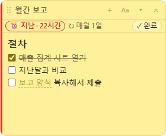

# 할 일 노트 위젯 (todonote, #111)

> **1.1.0부터 정식 위젯**입니다(0.0.x는 Gitea 내부 시험판). 다운로드 페이지와 위젯 관리 창에서 설치할 수 있고, 엔진 1.1.1 이상이 필요합니다. **스티키 노트·할 일 목록은 할 일 노트로 합쳐졌습니다**(#110 계획대로 할 일 노트 정식 배포 뒤 적용, #117): 두 위젯은 1.1.1에서 더 이상 새 버전이 나오지 않지만 계속 내려받아 쓸 수 있습니다. 옮기는 법은 아래 "스티키 노트·할 일 목록에서 옮기기".

**할 일 노트**는 스티키 노트 위젯([스티키 노트](memo.md))을 바탕으로 만든 **별도 위젯**입니다(id `todonote`, 설치 파일 `DeskWidgets-TodoNoteWidget-Setup-<버전>.exe`, 제어판 **Desk Widgets-TodoNoteWidget**). 노트마다 창 하나, 문서 폴더의 Markdown 파일로 저장하는 것은 스티키 노트와 같고, **날짜를 걸면 그 노트가 할 일**이 됩니다. 스티키 노트는 그대로이며 둘을 함께 설치해도 됩니다.

- 기본 폴더: `문서\Desk Widgets\할 일 노트`(스티키 노트의 `스티키 노트` 폴더와 따로). 설정에서 바꿀 수 있습니다. **두 위젯이 같은 폴더를 쓰게 하지 마세요**: 같은 파일을 두 위젯이 함께 열면 서로의 저장을 "바깥에서 바뀜"으로 봅니다.
- 엔진 동기화를 켜도 노트 폴더는 바뀌지 않습니다. 노트는 항상 이 PC의 노트 폴더에 있고, 엔진이 그 변경을 동기화 폴더로 주고받습니다.
- **노트 폴더 바꾸기**: 폴더를 바꾸면 **"기존 노트를 새 폴더로 옮길까요?"** 를 묻습니다(#108). **옮기기**: 노트(.md·.txt), 첨부 폴더(파일 이름.assets), 보관함·완료 폴더의 노트를 새 폴더로 복사하고 내용을 바이트 단위로 확인한 뒤 원래 파일을 **휴지통**으로 보냅니다(되살릴 수 있음, "옮긴 뒤에도 원래 폴더에 파일 남기기"를 켜면 남김). 노트가 아닌 다른 파일은 옮기지 않습니다. 새 폴더에 같은 이름의 노트가 있으면, 첨부가 없는 노트는 파일 이름만 "제목 (2)"로 옮기고(제목은 그대로), 첨부가 있는 노트는 이미지 연결이 깨지므로 **아무것도 옮기지 않고** 그 이름을 알려 줍니다. 복사가 하나라도 실패하면 만든 사본을 지우고 폴더도 바꾸지 않습니다. 옮긴 결과는 목록 창 위에 한 줄로 알려 줍니다. **옮기지 않기**: 새 폴더의 노트를 보여 주고 원래 폴더는 그대로 둡니다. **취소**: 폴더를 바꾸지 않습니다. 동기화 중에는 어느 쪽이든 다른 PC의 노트가 지워지지 않습니다. 엔진이 폴더가 바뀐 것을 알아보고 그 노트 저장소를 처음 연결처럼 다시 맞추기 때문에, 새 폴더에 없는 노트는 삭제로 보내지 않고 다른 PC에서 받아옵니다.
- 쓰기·창·목록·[[링크]]·바깥 편집·안전, **제목과 파일 이름**(#113, 파일 이름은 `YYYYMMDD-HHmmss-<노트 id>.md`로 바뀌지 않고 제목은 머리말 `title:`에만 있음), 노트 메뉴의 **정보…** 는 [스티키 노트](memo.md) 1~8장과 같습니다. 할 일 목록의 항목 오른쪽 클릭에도 **정보…** 가 있습니다(노트를 열고 정보 판을 보임). 같은 제목의 노트가 여럿이면 `[[제목]]`은 열 수 있는 노트 → 완료한 노트(**가장 최근에 완료한 것**) → 충돌 사본 → 보관함 순으로 엽니다. 머리말의 노트 id 키도 같은 `desk-widgets-memo`라 노트 파일을 두 폴더 사이에 옮겨도 그대로 알아봅니다. 스티키 노트의 예전 `메모` 폴더 옮기기(#95)는 없습니다.
- 설계와 결정: [스티키 노트 + 할 일 통합 설계](todonote-design.md)(#110, 13장에 구현에서 달라진 점).
- 노트 창의 **제목을 한 번 클릭하면 접히거나 펼쳐지고, 두 번 클릭하면 이름을 바꿀 수 있습니다.** 이름을 바꿀 때 Enter 또는 다른 곳을 클릭하면 저장하고 Esc는 취소합니다. 창을 옮길 때는 **제목을 누른 채 끌거나** 제목 왼쪽의 **⋮⋮ 손잡이**를 끕니다.
- **트레이 메뉴**(#118): 할 일 노트가 켜져 있으면 트레이 아이콘 오른쪽 클릭 메뉴에 **새 할 일 노트**와 **할 일 노트 목록**이 있습니다. **새 할 일 노트**는 목록 창을 열지 않아도 노트 창의 **새 노트**와 똑같이 새 노트를 만들고, 그 창이 화면 가운데 앞으로 나와 바로 쓸 수 있습니다. **할 일 노트 목록**은 목록 창을 엽니다. 메뉴가 길어지지 않게 트레이에는 **할 일 노트 설정**을 두지 않습니다(목록 창의 오른쪽 클릭이나 위젯 관리 창의 **설정**으로 엶). 엔진 API 1.9 이상의 엔진에서 보이고, 그보다 예전 엔진에서는 메뉴에 없을 뿐 나머지는 그대로입니다.


설계와 결정은 [스티키 노트 + 할 일 통합 설계](todonote-design.md)(#110)에 있습니다. 날짜가 없는 노트는 지금까지와 똑같습니다(띠에 흐린 ⏰ 버튼 하나만 더해짐).

 

### 날짜 걸기

- **⏰ 버튼**, 마감 칩, **Ctrl+Shift+D**, 오른쪽 클릭 → **날짜 정하기…**: 작은 날짜 창이 열립니다. "내일 3시", "10/30", "다음 주 월요일 오후 3시", "매월 1일 오전 9시", "완료 후 30일"처럼 치면 바로 아래에 해석 결과가 보이고 Enter로 적용합니다. 읽을 수 없으면 "알 수 없는 날짜"(빨강)이고 적용되지 않습니다. 오늘·내일·다음 주 월·주말 단추, **🕘 시간**(시각 고르기, **종일**이면 시간 없이 그날 하루. 고른 시간은 날짜 단추·달력에서 날짜를 바꿔도 유지), **↻ 반복**(없음·매일·평일·매주 요일·매월 날·매년·완료 후…), **🔔 알림**(마감 시각·10분 전·1시간 전·전날 18시·끄기), 반복이면 **완료하면 체크 목록 비우기**, **달력에서 고르기**(창 안의 작은 월 달력, 작은 창이면 창 안에서 스크롤)가 있습니다.
- 날짜 창 바깥이나 다른 창을 클릭하면 날짜 창이 닫힙니다. **확인**을 누르기 전 입력한 내용은 적용되지 않습니다. ⏰ 버튼을 다시 누르거나 Esc로도 닫을 수 있습니다.
- **`/` 명령**: 줄 맨 앞이나 띄어쓰기 뒤에서 `/`를 치면 목록이 뜹니다. `/내일 3시`처럼 이어 치면 맨 위가 "⏰ 날짜: …"가 되고 Enter로 적용(친 글자는 지워짐). `/반복`, `/완료`, `/지우기`도 됩니다. `a/b`, `http://`, 코드 안의 `/`는 명령이 아닙니다.
- **첫 줄 제안**: 새 노트의 첫 줄이 날짜 문구로 끝나면(`보고서 제출 금요일 5시`) 줄 끝에 흐린 칩 `⏰ 금 (10/30) 17:00?`이 보이고, **Tab**이나 칩을 누르면 적용됩니다(첫 줄에서 날짜 문구가 빠짐). 저절로 적용되지는 않습니다.


**읽는 문구**: 오늘·내일·모레·글피, 3일 뒤·2주 뒤·다음 달, 금요일·금·이번 주 금·다음 주 월요일·주말, 10/30·10.30·10월 30일·30일·2026-10-30·2027년 1월 5일, 오후 3시·3시 반·15:30·아침(9시)·점심·저녁(18시)·밤(21시), 반복 매일·평일·주말마다·매주 금·매주 월수금·격주 화·매월 1일·매월 말일·매월 첫째 월요일·매월 마지막 금요일·매년 3월 15일·3일마다·2주마다·3개월마다·완료 후 30일/2주/3개월, 영어 today·tomorrow·fri·next mon·3pm·every fri·every month on 1·every 2 weeks·after 30 days. `10/30`은 월/일이고 이미 지난 날짜면 내년, 오전/오후 없이 1~6시는 오후(`금요일 5시` = 17:00), 시각만 쓰면 오늘(지났으면 내일).

### 마감 줄과 완료

- 날짜가 걸린 노트는 띠 아래에 얇은 **마감 줄**이 생깁니다: 마감 칩(지남 빨강 + 창 왼쪽 빨간 띠, 오늘 주황, 곧, 나중 흐림) · ↻ 반복 · **✓ 완료**(Ctrl+Enter). 접은 창은 띠에 점(지남 빨강·오늘 주황)으로 보입니다. 반복 노트가 2번 이상 밀렸으면 `지남 · 2회`.
- **완료**(반복 없음): 창이 흐려지며 닫히고 노트는 `완료` 폴더로 갑니다. 목록이 열려 있으면 목록에, 아니면 짧은 알림 카드로 "… 완료 · **되돌리기**"(8초 안에 누르면 원래대로, 창도 다시 열림).
- **완료**(반복): `due`가 다음 회차로 넘어가고(밀린 회차는 건너뛰고 오늘 뒤의 첫 회차로), 체크 목록 비우기가 켜져 있으면 `- [x]`를 모두 `- [ ]`로 바꾸고(코드 블록 안은 그대로), 창이 닫힙니다. 다음 알림 때 **창이 같은 자리에 다시 열립니다**(설정).
- 오른쪽 클릭: 날짜 바꾸기… · 반복… · 완료 · **날짜 지우기**(노트로 되돌리기). 완료 폴더의 노트는 열 수 있고 마감 줄의 **↩ 되살리기**로 되돌립니다.

### 알림

- 시각이 있는 할 일은 그 시각(또는 정한 만큼 전)에, 종일 할 일은 그날 **오전 9시**(설정)에 알림 카드가 뜹니다: **완료** · **N분 뒤**(설정, 기본 10분) · **노트 열기**, 카드의 ⋯ 메뉴에 다시 알림 10분·30분·1시간·오늘 저녁·내일 아침. 노트 창이 닫혀 있어도 알립니다(폴더 전체 색인에서 계산).
- 알림을 보였는지·다시 알림은 위젯 설정 파일에만 적고 노트 파일은 바꾸지 않습니다(동기화·다른 편집기와 덜 부딪힘, PC마다 따로).
- PC가 꺼져 있던 동안 지난 알림은 12시간 안의 것만 뒤늦게 뜨고, 그보다 오래된 것은 **"지난 할 일 N개 · 목록 보기"** 카드 한 장으로 모입니다.


### 목록


탭이 **노트 · 할 일 · 완료 · 보관함** 4개입니다. **할 일**(옆 숫자 = 지남+오늘)은 지남·오늘·곧(7일 안)·나중으로 묶고 마감 빠른 순, 오른쪽 클릭 → 완료·날짜 바꾸기·노트 열기. **완료**는 "완료 10/20 · 9일 뒤 삭제"를 보이고 ↩ 되살리기·🗑, 아래에 **휴지통 열기**. 노트 탭의 할 일 노트에는 오른쪽에 작은 마감 칩이 붙습니다.

### 완료 폴더와 자동 삭제

- 완료하면 노트 파일이 **같은 이름 그대로** `완료` 폴더로 옮겨집니다(첨부 폴더도 함께, 이미지 경로는 그대로)(#113). 같은 제목의 할 일을 여러 번 완료해도 파일 이름은 노트마다 달라 `(2)`, `(3)`이 쌓이지 않습니다.
- **되살리기**(완료 취소)하면 같은 이름 그대로 노트 폴더로 돌아갑니다(그 폴더에 같은 이름의 다른 파일이 있을 때만 ` (2)`).
- **예전 판에서 업데이트하면** 스티키 노트와 같은 한 번 정리([스티키 노트](memo.md) 1장)를 노트 폴더·`보관함`·`완료` 모두에 합니다. 0.0.4-test.8이 만든 `완료YYYY-MM-DD 제목.md`도 id 이름으로 바뀝니다. 고친 시각은 그대로라 자동 삭제 기간도 그대로입니다.
- 설정 **완료한 노트 자동 삭제**: 7일·14일·**30일(기본)**·90일·1년·삭제 안 함. 기준은 **완료 시각과 파일을 마지막으로 고친 시각 중 늦은 것**(완료 뒤 다른 편집기 등에서 고친 노트는 고친 날부터 다시 셈).
- 지우는 것은 **Windows 휴지통으로 옮기기**뿐입니다(영구 삭제 없음). 휴지통으로 못 옮기면(네트워크 드라이브 등) 지우지 않고 목록에 알립니다. 위젯을 켤 때와 6시간마다, 한 번에 50개까지.
- 대상은 `완료` 폴더에 있고 위젯 id와 올바른 `completed`가 있으며 반복이 없는 노트뿐입니다. 손으로 넣은 파일·깨진 머리말·열려 있는 노트·반복 노트·보관함의 노트는 지우지 않습니다. 설정 화면에 "지금 기준 N개가 휴지통으로 갑니다"가 보입니다.

### 머리말 키

```markdown
---
title: 월간 보고
desk-widgets-memo: 3f9a1c2e…
due: 2026-11-01 09:00
repeat: 매월 1일
remind: 30분 전
reset-checks: true
---
```

| 키 | 값 |
|---|---|
| `title` | 노트 제목(#113, 스티키 노트와 같음). 파일 이름은 `YYYYMMDD-HHmmss-<id>.md`라 제목은 이 값에만 있음. 없으면(위젯이 만들지 않은 파일) 파일 이름이 제목. 위젯이 저장·이름 바꾸기 때 씀(YAML에서 다르게 읽힐 값은 `"…"`로 감쌈) |
| `created` | 노트를 만든 때(ISO, #113). 새 노트에 위젯이 한 번 씀. 정보… 의 "만든 때" |
| `due` | `YYYY-MM-DD`(종일) 또는 `YYYY-MM-DD HH:mm`. **할 일인지 정하는 유일한 키**(반복 노트에서는 지금 회차). `2026-11-01T09:00`도 읽음 |
| `repeat` | 반복 문구(위젯은 `매월 1일`처럼 정리해서 씀, 읽을 때는 위 문구 모두) |
| `remind` | `마감`, `N분 전`, `N시간 전`, `N일 전 HH:mm`, `없음` |
| `completed` / `last-done` | `YYYY-MM-DD HH:mm`(완료 / 반복 노트의 마지막 완료) |
| `reset-checks` | `true`/`false`(없으면 설정의 기본값, 기본 켬) |
| `source`, `source-id`, `source-url` | 두레이·메일·할 일 목록에서 온 노트(같은 원본을 두 번 만들지 않음) |

- 시각은 이 PC의 현지 시각(시간대 표시 없음). 키 이름은 대소문자 구분 없이 읽고, 같은 키가 두 번이면 첫 번째. 값이 잘못되면(`due: 내일쯤`) 그 키만 무시하고 파일은 고치지 않으며 마감 줄에 "⚠ 날짜를 읽을 수 없음 · 다시 정하기"가 보입니다.
- 위젯은 **자기 키의 줄만** 바꾸고 `tags`·`aliases` 같은 다른 줄과 순서는 그대로 둡니다. 다른 편집기에서 `due`·`repeat`·`completed`를 고치면 창·목록·알림·캘린더가 따라갑니다.

### 스티키 노트·할 일 목록에서 옮기기 (#117)

- **할 일 목록**: 할 일 노트 설정의 **할 일 목록 위젯에서 가져오기**를 누릅니다(아래 "연동과 가져오기"). 할 일 목록 위젯의 데이터는 그대로 남습니다.
- **스티키 노트**: 같은 Markdown 노트 파일이라 그대로 열립니다. `문서\Desk Widgets\스티키 노트`의 노트 파일(첨부 폴더 `파일 이름.assets` 포함)을 `문서\Desk Widgets\할 일 노트`로 옮기세요. 머리말의 노트 id 키가 같아 할 일 노트도 같은 노트로 알아봅니다. **두 위젯의 노트 폴더를 같은 폴더로 설정하지는 마세요**(같은 파일을 두 위젯이 함께 열면 서로의 저장을 "바깥에서 바뀜"으로 봅니다).

### 연동과 가져오기 (엔진 API 1.7)

- 설정 **두레이에서 받기**·**메일에서 받기**·**캘린더에 마감 표시**(모두 기본 끔). 두레이 업무·메일을 "할 일에 추가"하면 **본문이 든 노트**가 만들어지고 열립니다: 원본 링크·프로젝트·담당·마감(두레이), 보낸 사람·받은 시각(메일), 본문은 글자만 20,000자까지, 첨부는 이름만. 같은 업무·메일을 다시 추가하면 그 노트를 엽니다. 캘린더는 "노트 마감"을 보이고 날짜를 바꾸면 노트의 `due` 줄만 바뀌며, 상세의 **노트 열기**로 노트를 엽니다.
- **보낼 곳**: 두레이·메일의 "할 일에 추가"는 할 일 노트가 설치돼 있으면 할 일 노트로, 아니면 할 일 목록 위젯으로 갑니다. 둘 다 설치돼 있으면 두레이·메일 설정 **할 일 연동** 아래에 **추가할 곳: 할 일 노트(기본) / 할 일 목록 (이전)**이 보이고, 고른 쪽이 꺼져 있는데 다른 쪽이 켜져 있으면 켜진 쪽으로 보냅니다. 스티키 노트는 받는 쪽이 아닙니다(셋 다 설치돼 있어도 고르는 것은 할 일 노트와 할 일 목록 둘). 캘린더는 **노트 마감**(기본 켬, 할 일 노트 쪽 "캘린더에 마감 표시"가 켜져야 보임)과 **할 일 목록** 오버레이(이미 켠 사람에게만 보임)를 따로 켜고 끕니다. 두 오버레이의 색은 캘린더 설정 **할 일 연동**의 **노트 마감 색**·**할 일 마감 색**에서 바꿉니다(기본 노랑·주황, 다른 PC와 동기화).
- **엔진 허용 표(API 1.7)**: `dooray`·`mail → todonote: notes.addExternal, notes.open`, `calendar → todonote: notes.snapshot, notes.updateDue, notes.open`, 이벤트 `todonote → calendar: notes.changed`, 가져오기 `importLegacy('todo')`(할 일 노트만). 할 일 목록(`todo`) 줄은 그대로라 두 위젯이 함께 동작합니다. 캘린더 표시 id는 `todonote:<노트 id>`, 역량 이름은 `notes-receive-external`·`notes-calendar-share`. #94의 "본문·첨부 자동 복사하지 않음"은 할 일 노트에 대해서만 이 범위(본문 글자 20,000자, 첨부 이름)로 바뀝니다.
- **할 일 목록 위젯에서 가져오기**(설정): 날짜·반복이 있는 할 일은 하나씩 노트로, 날짜 없는 할 일은 목록마다 체크 목록 노트(`할 일 - 목록 이름`) 하나로. 완료한 것은 고르면 `완료` 폴더로. 할 일 목록 위젯의 데이터는 그대로이고, 엔진이 읽기 전용으로 읽어 건넵니다(위젯끼리 파일을 직접 읽지 않음). 다시 눌러도 같은 할 일을 두 번 가져오지 않습니다.
- 엔진 API 1.2~1.6에서는 노트·할 일·알림은 되고 연동과 가져오기만 빠집니다(설정에 안내).

### 알려진 제한

- 캘린더에는 반복 노트의 **지금 회차만** 보입니다(앞으로의 회차는 그리지 않음, 결정 J).
- 다시 알림 상태는 PC마다 따로입니다. 같은 노트 폴더를 두 PC에서 쓰면 알림은 PC마다 뜹니다.
- 메일에서 추가할 때 날짜를 고르는 창은 아직 없습니다(날짜 없는 노트로 만들어지고 노트에서 ⏰로 겁니다).
- "완료" 알림 카드가 화면에 남는 시간은 엔진의 알림 표시 시간 설정을 따릅니다(되돌리기는 완료 뒤 약 10초 안에만 됨).

### 구조 (개발자용)

스티키 노트(`widgets/memo`)의 파일 구성에 다음이 더해졌습니다. 위젯끼리 코드를 공유하지 않으므로(#40) 스티키 노트와 같은 파일도 각자 복사본입니다. IPC 채널은 `todonote-widget`(스티키 노트는 `memo-widget`).

| 파일 | 역할 |
|---|---|
| `lib/dates.js` | 날짜·반복 문구 해석(할 일 위젯 해석기를 복사해 넓힘), 반복 계산, 알림 시각 (#111) |
| `lib/frontmatter.js` | 머리말의 할 일 키 읽기/쓰기(자기 줄만) |
| `lib/todo.js` | 마감 상태·칩 글자, 완료가 쓰는 것, 체크 비우기, 알림·자동 삭제 대상, 캘린더 스냅샷 |
| `lib/external.js` | 두레이·메일에서 만드는 노트, 할 일 목록 가져오기 계획 |
| `memo/`, `list/`, `preload.js` | 노트 창·목록 창 화면(위젯 자체 페이지) |

## 엔진 동기화 폴더 (#108)

엔진 1.1.1(API 1.8)부터 엔진의 동기화 폴더를 켜면 노트의 `.md`·`.txt` 파일과 같은 이름의 `.assets` 첨부 파일을 동기화합니다. 일반 노트, `보관함`, `완료` 폴더가 포함됩니다. 마감 날짜·반복·완료 정보는 노트 머리말에 있으므로 노트와 함께 이동합니다. 노트별 색과 새 노트의 표시 설정도 공유합니다.

창 위치·열림 상태, 알림을 이미 보여준 기록·다시 알림 상태, 완료 노트 자동 삭제 기간, 두레이·메일·캘린더 연동 허용은 PC마다 따로 둡니다. 노트 폴더는 이 PC의 폴더 그대로이며 엔진의 파일 저장소가 감시하고 주고받습니다. 노트 폴더가 동기화 폴더와 겹칠 때만(그 안이거나 그 폴더를 품을 때) 엔진이 노트 파일을 주고받지 않습니다. 문서 폴더를 OneDrive로 백업해 노트 폴더가 OneDrive 안에 있어도 주고받습니다(현장 테스트: 그 경우를 건너뛰어 나중에 연결한 PC에 노트가 오지 않았음). 새 PC에서는 연동을 그 PC의 설정에서 직접 켜야 합니다. 파일 하나의 전송 한도는 20MB입니다. 동기화 폴더의 접근 권한이 있는 사람은 노트 내용을 볼 수 있습니다.
